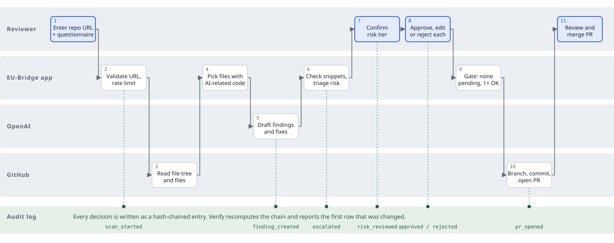

# EU-Bridge

EU-Bridge finds what blocks your AI product from the EU market, drafts the code fix, and puts a human in charge of every change.

Built for Agentika 2.0 (NaSCon 2026). Theme: *Human + AI: Better Together*.

> EU-Bridge offers decision support, not legal advice.

## The problem

Since 2 August 2026, AI products used in the EU must meet the EU AI Act's transparency rules (for example, telling users they are talking to an AI, Article 50) on top of GDPR. This applies to companies outside the EU as well. Small teams with no legal staff don't know which rules apply or what to change in their code.

Most compliance tools produce a report. EU-Bridge produces a **human-reviewed pull request** and a **tamper-evident record of who approved what**.

## How it works



1. A reviewer submits a public GitHub repo URL and a short questionnaire (what the product does, whether it uses an LLM, whether it handles personal data, and the domain).
2. The app reads the repo, keeps the files that contain AI-related code, and asks OpenAI for structured findings. The AI only drafts. It never changes code.
3. The app checks that each suggested snippet exists exactly once in the file. Findings it can't place, or that the AI is unsure about, are marked `needs_human`.
4. Risk triage is deterministic. Hiring, credit, education, health, biometrics and critical-infrastructure products are **escalated**, and the AI doesn't decide the tier. A person confirms it.
5. A reviewer approves, edits then approves, or rejects each finding, one at a time, with a name and a reason.
6. When nothing is pending and at least one fix is approved, the app commits the approved fixes to a new branch and opens a pull request that lists each fix and who approved it.
7. Every step is written to a hash-chained audit log that can be verified and exported.

### Where a human is in the loop

| Gate | Rule |
|---|---|
| Risk tier | Escalated scans need a reviewer's name and reason to confirm the tier. No pull request can be opened until they do. |
| Every fix | Approve, edit then approve, or reject. Reviewer name and a reason of 5+ characters are enforced by the server. There is no bulk approve. |
| Unsure findings | Low confidence (under 0.6) or an unmatched snippet becomes `needs_human`. An unmatched snippet can only be rejected and fixed by hand. |
| Pull request | Blocked while any finding is pending. Failed patches are reported, not dropped. |
| Merge | A person merges the PR on GitHub. |

## The four checks

| ID | Check | Source |
|---|---|---|
| `AIA-50-1` | A chatbot tells users it is an AI | EU AI Act Art. 50(1) |
| `GDPR-13` | Users are told their data goes to a third-party AI | GDPR Art. 13, Art. 28 |
| `GDPR-5-1C` | No personal data in logs | GDPR Art. 5(1)(c), Art. 32 |
| `AIA-RISK` | Risk-tier triage (escalation only, no code fix) | EU AI Act Art. 5, Annex III, Art. 14 |

## Audit log

Each entry stores `sha256(prev_hash + canonical_json(entry))`, starting from 64 zeros. `GET /api/audit/verify` recomputes the chain and reports `{ok, broken_at}`. The log is **tamper-evident**, not immutable: editing or removing an earlier entry is detected, while removing the newest entries is not.

## API

| Method | Path | Purpose |
|---|---|---|
| GET | `/healthz` | Health check |
| POST | `/api/scans` | Start a scan: `{repo_url, questionnaire}` |
| GET | `/api/scans/{id}` | Scan, findings and counters |
| POST | `/api/findings/{id}/review` | `{action: approve \| edit_and_approve \| reject, reviewer, reason, final_patch?}` |
| POST | `/api/scans/{id}/risk-review` | Confirm the risk tier: `{reviewer, reason}` |
| POST | `/api/scans/{id}/pr` | Apply approved fixes and open the PR |
| GET | `/api/audit/verify` | Verify the hash chain |
| GET | `/api/audit/export` | Download the log as JSON |

Example scan request:

```bash
curl -X POST http://localhost:8000/api/scans \
  -H "Content-Type: application/json" \
  -d '{"repo_url":"https://github.com/Ayesha123-kh/eu-bridge-demo-chatbot","questionnaire":{"description":"CV screening bot","uses_llm":true,"processes_personal_data":true,"domain":"hiring"}}'
```

## Status

Built: scanner, triage, review rules, patcher, PR creation, audit log, JSON API, web UI (scan form, review page, audit page), tests.

## Run locally

```bash
python -m venv .venv && source .venv/bin/activate
pip install -r requirements.txt
cp .env.example .env        # then fill in the two secrets
uvicorn app.main:app --port 8000
pytest
```

## Configuration

| Variable | Required | Notes |
|---|---|---|
| `OPENAI_API_KEY` | yes | Never logged or displayed. |
| `GITHUB_TOKEN` | yes | Fine-grained token for the **target repo** (the repo being scanned), with Contents and Pull requests set to read and write. |
| `OPENAI_MODEL` | no | Default `gpt-4o-mini`. |
| `PORT` | no | Default `8000`. |
| `APP_ENV` | no | `staging` or `production`. |
| `DATA_DIR` | no | SQLite location, default `./data`. Resets on redeploy. |
| `MAX_FILES` / `MAX_FILE_BYTES` | no | Defaults `40` / `40000`. |

The app exits at startup with `Missing env var: NAME` if a required variable is unset.

## Deployment

| Environment | Branch | Host | Notes |
|---|---|---|---|
| Staging | `staging` | Railway | Redeploys on every push. Used for testing. |
| Production | `main` | Alternate Clouds | One service. A push does not redeploy: click **Rebuild**, then **Deploy**. Set PORT to `8000` in the Source tab. |

The Docker image runs `uvicorn app.main:app` on `$PORT`.

## Demo target

[`eu-bridge-demo-chatbot`](https://github.com/Ayesha123-kh/eu-bridge-demo-chatbot) is a deliberately non-compliant chatbot. It logs user emails, sends messages to OpenAI with no notice, and has no AI disclosure. Its README describes it as a CV-screening assistant, which triggers escalation when the domain is "hiring".

## Out of scope

User accounts, private repos, GitLab, background queues, and full coverage of the AI Act or GDPR. Four checks, done well.
